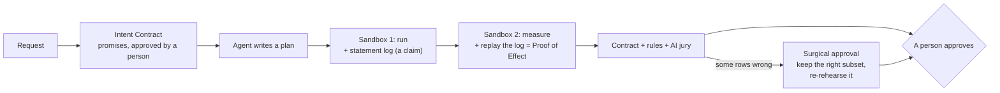

# The Consequence Engine

Today Stunt Double can say **no**. The Consequence Engine lets it say **"here is exactly why, here is exactly the
part that is right, and here is the promise every plan must keep."** Three mechanisms, each one new, each one
demonstrable in a single click, all built on what already exists (two-phase sandbox, row-level effects, learned rules,
the AI jury).

The challenge asks entries to *plan, dispatch, verify* and rewards the *ability to demonstrate behaviors*. Every
competitor will verify. Nobody else will **verify the verification**, **repair a wrong plan without the agent**, or
**make the agent sign a contract before it writes a line**.

---

## 1. Surgical approval: the wrong plan becomes the right outcome

**The moment.** The agent's refund plan is 86% wrong: 744 refunds, 640 of them to people never double-charged. Today
the only answers are reject, or ask the agent to try again. With the engine, the approval card says:

> **104 of these 744 changes are right.** Approve just those?

One click, and the right 104 refunds and 104 apology emails go out. The 640 never happen. No new plan, no second
AI round trip, no waiting.

**How it works.**
1. The jury's catch (and every learned rule) is a SQL query that returns the *offending rows*.
2. The engine walks the effect graph from those rows: a charge row → its refund (by `charge_id`) → its customer's
   email. That gives the **minimal set to drop** and the **maximal safe subset to keep**.
3. The subset is not trusted either: it is replayed onto a fresh copy **in a new sandbox**, measured by phase 2 like
   any rehearsal, and checked again by every rule (and the jury, cached). Only then is it offered.
4. Approving it binds the approval to the subset's own SHA-256. The original plan is recorded as "partially approved".

**Why it's new.** Agent safety tools are binary: allow or block. This is the first that can **cut the harm out of a
plan and keep the work**, with the cut itself rehearsed and verified.

## 2. Proof of Effect: every number has a reason

**The moment.** The approver clicks "640 wrong refunds" and sees the exact line of the plan that caused them:
`... GROUP BY customer_id, amount_cents, date(created_at) HAVING COUNT(*) > 1`, highlighted, with "this statement changed
640 rows". Every changed row in the explorer gets a **"why"**: the statement that touched it.

**How it works.**
1. In phase 1, the harness records every SQL statement the plan runs (a trace callback on the copy). This log is a
   **claim**, made by untrusted code, and is treated as one.
2. In phase 2, trusted code **replays only those statements**, one by one, on a fresh copy of the "before" data, with
   an authorizer that refuses anything but data changes. After each statement it diffs, so every changed row is
   attributed to the statement that changed it.
3. If the replayed result equals the measured result, the provenance is **proven**. If not, the plan changed something
   it didn't declare (a second connection, a file swap, a disabled trace) and the run is flagged:
   **"N changes the plan can't explain"**. That locks approval.

**Why it's new.** "The plan can't lie" today means we measure what changed. Proof of Effect goes one level deeper:
**we also prove why it changed**, and an agent that hides its tracks is caught by arithmetic, not by trust. Git blame,
for consequences.

## 3. Intent Contracts: the agent signs before it writes

**The moment.** You type "Refund everyone who was double-charged last week." Before any agent writes a plan, Stunt
Double shows three promises in plain English:

> ✓ Only orders with two charges are refunded.
> ✓ Exactly one refund per such order, for the extra charge.
> ✓ Only refunded customers get an apology email.

You approve the contract once (three lines, not code). Then *any* plan, from any agent, any number of retries, is
checked against it deterministically in phase 2, in milliseconds, without asking the AI again.

**How it works.**
1. The jury compiles the request (plus the business glossary) into 2–4 promises, each a plain sentence and an
   after-state SQL check, the same shape as learned rules.
2. Each check must pass on today's data, and must not contradict the glossary.
3. The human approves the contract. It travels with the run: the agent sees it, phase 2 enforces it, the evidence
   bundle records it.

**Why it's new.** Today's verifiers judge *after* the fact and can be talked into anything. Intent Contracts move the
specification **before the plan exists**, so the agent is measured against what the person meant, written down
before anyone had a reason to bend it. Learned rules are contracts discovered *after* a mistake. Intent contracts are
promises made *before* one.

---

## How the three fit

## Build order (1.5 days, then freeze)

| # | What | Why first | Est. |
|---|---|---|---|
| 1 | **Surgical approval** | the most visible demo moment; turns a "no" into a "yes, this much" | ~0.5 day |
| 2 | **Proof of Effect** | deepens the core claim; makes every number clickable | ~0.5 day |
| 3 | **Intent Contracts** | reuses the rules engine; completes the story (before, during, after) | ~0.5 day |

Each ships only with tests (including adversarial ones: a plan that disables the trace, opens a second connection, or
hides a write in a trigger), the full suite green, and the production end-to-end test passing. Then the freeze.
