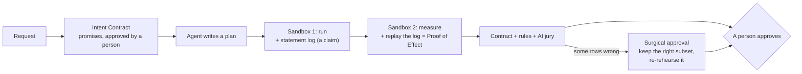

# The Consequence Engine

Today Stunt Double can say **no**. The Consequence Engine lets it say **"here is exactly why, here is exactly the
part that is right, and here is the promise every plan must keep."** Three mechanisms, each one new, each one
demonstrable in a single click, all built on what already exists (two-phase sandbox, row-level effects, learned rules,
the AI jury).

The challenge asks entries to *plan, dispatch, verify* and rewards the *ability to demonstrate behaviors*. Every
competitor will verify. Nobody else will **verify the verification**, **repair a wrong plan without the agent**, or
**make the agent sign a contract before it writes a line**.

---

## Status: built, and measured on the live server

All six milestones shipped, each with tests (`api/tests/test_engine_*.py`, 196 tests in the suite) and a production
run. The code is in [`api/app/engine/`](../api/app/engine): `graph`, `materialize`, `subsets`, `state`, `contracts`,
`verdict`, `evidence`; Proof of Effect lives in the sandbox harness (`api/app/harness/runner.py`).

**The demo moment on production** (Nov 5, the obvious refund plan, judge step 1):

| Step | What happened |
|---|---|
| Contract | `qwen3.8-flash-next` wrote 4 promises from the request, glossary and schema alone: 2 pieces of work (104 refunds, 104 apology emails) and 2 guards |
| Rehearsal | 744 refunds, 744 emails, 744 rows. Proof of Effect: 1,490 statements replayed, 744 of 744 changes reproduced |
| Check | guard "only those extra charges are refunded" **broken by 640 rows**; both pieces of work met; jury 3 of 3 *dangerous* |
| Decision | **cut**: "Approve just the 104 of 744 changes that pass the check", driven by the contract alone |
| Subset | re-measured in a fresh sandbox: 104 refunds, 104 emails; all 4 promises kept; jury 3 of 3 *looks right*; decision **approve** |
| Evidence | 7 entries (request → contract → rehearsal → rehearsal → surgical → jury → decision), Ed25519-signed, verifies |

**What changed from the plan, and why**

- *Promises read three views, not one.* A promise defined only on the after-state defeats itself: once the plan refunds
  a double charge, the order no longer "has two successful charges". So each check sees the data **before** the plan
  (`before.*`), **after** it, and what it **sent** (`sent.refunds`, `sent.emails`, `sent.requests`). With that, the
  same model went from counting 58 or 72 orders to exactly 104.
- *Dates are literal.* The model is given the business's "today" and the glossary's "last week"; a promise that uses
  `'now'` is refused, because it would mean something different tomorrow.
- *Unfair promises are withdrawn, not enforced.* A promise that a jury-approved plan for the same request fails is the
  contract's mistake. Live, DeepSeek wrote one ("an apology contact is recorded in the database") that no correct plan
  can meet; it was withdrawn automatically.
- *A cut must pass every check that fired, and do some of the work.* Found on production: the lying "read-only audit"
  broke two promises, and cutting around only the first left a subset that still broke the second. Now every learned
  rule and broken promise is required on the subset, and a request that asks for no change gets no subset at all.
- *A person can strike a promise.* Under review, any promise but the last can be struck with a written reason; the
  rehearsal is re-checked with no AI, and the strike is a step of the signed record.
- *Ambiguity is detected, not guessed.* After the contract is ready, a second model from another lab writes its own
  reading. If the two find different amounts of work ("104 to do, or 58"), the request is ambiguous and the decision
  asks a person. Live, DeepSeek agreed with Qwen on 104.
- *The effect graph is browsable.* In the console, every unit of work is a square; clicking one shows its parts and
  the reason for every link (`GET /api/runs/{id}/graph?unit=N`).
- *Agents see the engine.* MCP results carry the decision, the contract and the proof, and `keep_only_what_is_right`
  asks for the cut.
- *Checks run on an indexed private copy.* Model-written checks scanned the raw data; on the VM, judge step 1 took
  42 s. One indexed copy per version of the data made each check ~100x faster: the whole demo moment now takes
  8.6 s on production, offer to approvable subset, once the AI verdicts for it have been checked live (a live check
  of the subset takes about 2 minutes).
- *The contract and the jury are two independent readings.* Found by the golden-path e2e on production: shown the
  contract's results, the jury echoed a contract mistake (it had promised to keep a record of every server, so the
  correct cleanup "broke" it). Now the jury never sees the contract, and when the jury judges the outcome right but a
  promise is broken, neither wins: the decision says they disagree, approving needs a written reason (or the person
  strikes the promise), and only when both object, or the jury didn't run, does a broken promise lock approval.
- *See the contract before any plan.* "What does this mean?" in the console shows a typed request's contract and
  its cross-read (`POST /api/contract/preview`); the run that follows reuses it.
- *Verify the record in your own browser.* The decision panel re-hashes every step and checks the Ed25519 signature
  with WebCrypto, then changes one cent to show the chain breaking at that step. Sealed bodies carry no floats, so
  Python and JavaScript hash them byte for byte the same.
- *Built to be left running in public.* The two readings of a request run in parallel (a request neither model had
  seen: 23 s for both, where the sequential path took up to 82 s); a reading that fails is remembered rather than
  paid for again; and new contracts share a global daily budget, while a request seen before is always free.
- *A five-step guide.* When a run has a contract and a cut, a strip at the top tells its story and jumps to each card.
- *The agent signs before it writes.* In agent mode, the ops agent gets the promises with the request.
- *The decision is code, not AI.* Six layers give pass, warn or fail with one reason each; only deterministic layers
  lock approval, and the jury's objection alone asks a person for a written reason.

---

## 1. Surgical approval: the wrong plan becomes the right outcome

**The moment.** The agent's refund plan is 86% wrong: 744 refunds, 640 of them to people never double-charged. Today
the only answers are reject, or ask the agent to try again. With the engine, the approval card says:

> **104 of these 744 changes are right.** Approve just those?

One click, and the right 104 refunds and 104 apology emails go out. The 640 never happen. No new plan, no second
AI round trip, no waiting.

**How it works.**
1. The jury's catch (and every learned rule) is a SQL query that returns the *offending rows*.
2. The engine walks the effect graph from those rows: a charge row → its refund (by `charge_id`) → its customer's
   email. That gives the **minimal set to drop** and the **maximal safe subset to keep**.
3. The subset is not trusted either: it is replayed onto a fresh copy **in a new sandbox**, measured by phase 2 like
   any rehearsal, and checked again by every rule (and the jury, cached). Only then is it offered.
4. Approving it binds the approval to the subset's own SHA-256. The original plan is recorded as "partially approved".

**Why it's new.** Agent safety tools are binary: allow or block. This is the first that can **cut the harm out of a
plan and keep the work**, with the cut itself rehearsed and verified.

## 2. Proof of Effect: every number has a reason

**The moment.** The approver clicks "640 wrong refunds" and sees the exact line of the plan that caused them:
`... GROUP BY customer_id, amount_cents, date(created_at) HAVING COUNT(*) > 1`, highlighted, with "this statement changed
640 rows". Every changed row in the explorer gets a **"why"**: the statement that touched it.

**How it works.**
1. In phase 1, the harness records every SQL statement the plan runs (a trace callback on the copy). This log is a
   **claim**, made by untrusted code, and is treated as one.
2. In phase 2, trusted code **replays only those statements**, one by one, on a fresh copy of the "before" data, with
   an authorizer that refuses anything but data changes. After each statement it diffs, so every changed row is
   attributed to the statement that changed it.
3. If the replayed result equals the measured result, the provenance is **proven**. If not, the plan changed something
   it didn't declare (a second connection, a file swap, a disabled trace) and the run is flagged:
   **"N changes the plan can't explain"**. That locks approval.

**Why it's new.** "The plan can't lie" today means we measure what changed. Proof of Effect goes one level deeper:
**we also prove why it changed**, and an agent that hides its tracks is caught by arithmetic, not by trust. Git blame,
for consequences.

## 3. Intent Contracts: the agent signs before it writes

**The moment.** You type "Refund everyone who was double-charged last week." Before any agent writes a plan, Stunt
Double shows three promises in plain English:

> ✓ Only orders with two charges are refunded.
> ✓ Exactly one refund per such order, for the extra charge.
> ✓ Only refunded customers get an apology email.

You approve the contract once (three lines, not code). Then *any* plan, from any agent, any number of retries, is
checked against it deterministically in phase 2, in milliseconds, without asking the AI again.

**How it works.**
1. The jury compiles the request (plus the business glossary) into 2–4 promises, each a plain sentence and an
   after-state SQL check, the same shape as learned rules.
2. Each promise is classified by running it on today's data: 0 rows means a **guard** (must stay 0), some rows means
   an **obligation** (the work to be done, shown as "104 orders need a refund").
3. The human approves the contract. It travels with the run: the agent sees it, phase 2 enforces it, the evidence
   bundle records it.

**Why it's new.** Today's verifiers judge *after* the fact and can be talked into anything. Intent Contracts move the
specification **before the plan exists**, so the agent is measured against what the person meant, written down
before anyone had a reason to bend it. Learned rules are contracts discovered *after* a mistake. Intent contracts are
promises made *before* one.

---

## How the three fit

## Checked against the real demo data (before writing a line)

The bad refund plan selects 744 charges; the correct plan selects 104. **All 104 correct charges are inside the 744,
and the other 640 are exactly the wrong ones.** So surgical approval of the bad plan yields precisely the correct
outcome: 104 refunds, $5,136, 104 emails. The demo moment is real, not staged.

**Why it's needed (tested on today's system):** a plan that opens its own second connection, renames a customer and
logs "Read-only check: nothing changed" is already caught by the measurement (1 row changed), but nothing says *how*
it got around the declared channel. With Proof of Effect that same run reads **"1 change the plan can't explain"**,
and approval locks.

**Prototype of Proof of Effect (passed):** SQLite's trace hook records each statement with its bound values expanded;
replaying the log on a fresh copy with the same frozen clock reproduced the measured result exactly; and a write made
after the plan switched the trace off showed up as an unexplained row. The mechanism works before we build it.

**Email linkage on the demo data:** each of the 744 customers has exactly one refund, so every email maps to exactly one
keep-or-drop decision. In general, if one person has both a kept and a dropped change, the email is held back and named
in the card ("1 email needs a person to decide"), never guessed.

**Prototype of an Intent Contract (passed, live on Vultr Serverless Inference).** Given only the request, the glossary
and the schema, `deepseek-v4.1-flash-1017` wrote promises before any plan existed. Each was run on today's data, on
the correct plan's result and on the bad plan's result:

| Promise (the model's own words) | today | correct plan | bad plan |
|---|---|---|---|
| "No charge is refunded unless it belongs to an order that had exactly two charges…" | 0 | 0 | **640** |
| "Every order that had exactly two charges… has exactly one of those charges refunded…" | **104** | 0 | 0 |

The discovery: contracts contain two kinds of promise. **Guards** must hold before and after (the first row: it
catches the exact 640 wrong refunds, deterministically, with no AI at check time). **Obligations** are broken before
and kept after (the second row): they are the work itself. So the contract can say, **before the agent writes a line,
"104 orders need a refund"**, and the approval card can show "obligation met: 104 of 104". Stunt Double knows the
right answer before the agent starts. (`glm-5.3-flash` ran out of tokens on this prompt; the production loop's forced
decision and model fallback already handle that.)

## The hard parts, and the answers

| Risk | Answer |
|---|---|
| The plan disables the statement log, or writes through a second connection | the replay won't match the measurement: **"N changes the plan can't explain"**, approval locks. Tested adversarially |
| Statements that depend on the clock or randomness (`datetime('now')`, `random()`) replay differently | both phases install the same frozen clock and seeded random functions on the copy, so replays are exact |
| Large plans (10,000 statements) | per-statement diffing is capped; above the cap, provenance is proven in batches and attributed per batch |
| Linking a bad row to its refund and its email | refunds carry `charge_id`; emails link through the customer of that charge. Anything that can't be linked is kept out of the subset (fail closed) |
| The subset is itself wrong | it is re-rehearsed in a new sandbox and re-checked by every rule and the jury before it is offered |
| A contract the AI writes is too loose or too strict | it must pass today's data, the human approves it in plain English, and it is shown beside every verdict |

## The final plan

### The demo moment (the 30 seconds the whole build serves)

> A person types *"Refund everyone who was double-charged last week."*
> **Before any agent writes a line**, Stunt Double shows the contract: *"104 orders need a refund. Only orders with two
> charges may be refunded."* The person approves three plain sentences.
> The agent's plan comes back: 744 refunds. The engine draws the **Effect Graph** (744 charges → 744 refunds → 744
> emails), lights **640 nodes red**, and points at the exact line of the plan that caused them.
> One button: **"Approve the 104 that keep the contract."** A fresh sandbox re-rehearses the cut. Obligation met:
> 104 of 104. Money moves for exactly the right people.

Every competitor shows an agent being blocked. This shows an agent being **understood, corrected and trusted**, in one
screen, with every claim proven.

### Architecture: `api/app/engine/`, the core every surface goes through

| Module | What it is |
|---|---|
| `graph` | the **Effect Graph**: typed nodes (row change, refund, email, API call, server change) and edges (row → refund via `charge_id`, refund → customer → email, …). Built in trusted phase 2 from measured effects only |
| `provenance` | **Proof of Effect**: statement log (a claim) → trusted replay on the "before" copy with a frozen clock and an authorizer → per-row attribution → "unexplained changes" |
| `contracts` | **Intent Contracts**: compiled from the request and glossary by the jury; each promise classified as a **guard** or an **obligation** on today's data; enforced in phase 2; learned rules become contracts discovered after a mistake |
| `subsets` | **surgical approval**: offending nodes → graph closure → the maximal safe subset → re-rehearsed in a new sandbox → re-checked → offered with its own fingerprint |
| `verdict` | one decision object that combines contracts, rules, provenance and the jury, with a plain-English reason per part |
| `evidence` | the signed record: request, contract, plan, graph, provenance, verdict and decision, hash-chained |

The API, console, MCP server, SDK and CLI all call the engine; nothing decides outside it.

### Milestones, each one shipped green (tests + production e2e) before the next

| # | Milestone | You can see it when |
|---|---|---|
| M1 | **Effect Graph** in phase 2 + graph view in the console | every rehearsal draws its consequences as a graph |
| M2 | **Surgical approval** end to end | the bad refund plan offers "approve the 104" and applies exactly 104 |
| M3 | **Proof of Effect** | clicking any number shows the line that caused it; the hidden-connection plan is locked as unexplained |
| M4 | **Intent Contracts** (rules folded in) | the contract card appears before the plan; guards and obligations are checked in phase 2 |
| M5 | **Verdict + evidence** unified, hash-chained | one decision panel; the evidence bundle verifies end to end |
| M6 | **The story**: an engine section on the landing page, the README extended, judge mode rebuilt around the demo moment | a judge sees the engine in the first minute |

**Freeze: Sat ~05:00 IST.** After that only fixes for things that are broken.

### Rules for the build
- Every module has adversarial tests (a plan that disables the log, opens a second connection, games the subset, or
  writes a contract-shaped lie).
- Nothing on production regresses: the 11-step and new-features e2e suites pass after every milestone.
- Inference spend stays small: contracts and jury verdicts are cached by identical facts, as today.
